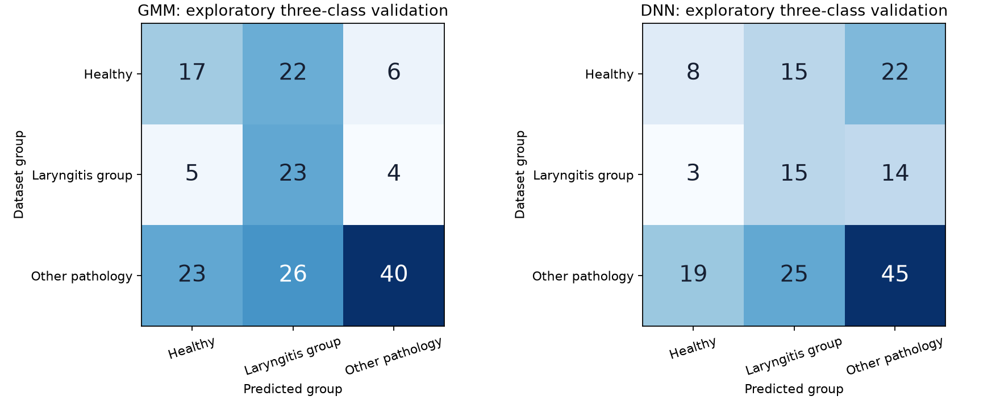

# Laryngeal label audit and exploratory extension

## Decision
The release has 38 reflux-laryngitis records and one hypokinetic-dysphonia record explicitly labelled laryngitis. There are 32 in development and seven reserved for final testing. This permits a small exploratory label-group experiment, not reliable clinical laryngeal detection. We do not infer anatomical absence from other diagnosis strings. Other pathology may also involve the larynx. Independent identity remains based on record IDs as participant proxies.

## Exact diagnosis audit
| Source diagnosis | Speaker proxies | Development | Reserved test | Assigned group |
|---|---:|---:|---:|---|
| healthy | 57 | 45 | 12 | Healthy |
| hyperkinetic dysphonia | 43 | 35 | 8 | Other pathology |
| hyperkinetic dysphonia  (rigid vocal fold) | 1 | 0 | 1 | Other pathology |
| hyperkinetic dysphonia (adduction deficit) | 1 | 1 | 0 | Other pathology |
| hyperkinetic dysphonia (cordite) | 1 | 0 | 1 | Other pathology |
| hyperkinetic dysphonia (nodule) | 5 | 4 | 1 | Other pathology |
| hyperkinetic dysphonia (polyps) | 6 | 5 | 1 | Other pathology |
| hyperkinetic dysphonia (prolapse) | 9 | 8 | 1 | Other pathology |
| hyperkinetic dysphonia (reinke's edema) | 3 | 2 | 1 | Other pathology |
| hyperkinetic dysphonia (vocal fold nodules) | 1 | 1 | 0 | Other pathology |
| hyperkinetic dysphonia (vocal fold paralysis) | 1 | 1 | 0 | Other pathology |
| hyperkinetic dysphonia (vocal fold prolapse) | 1 | 1 | 0 | Other pathology |
| hypokinetic dysphonia | 22 | 16 | 6 | Other pathology |
| hypokinetic dysphonia (adduction deficit) | 1 | 1 | 0 | Other pathology |
| hypokinetic dysphonia (bilateral vocal fold) | 1 | 1 | 0 | Other pathology |
| hypokinetic dysphonia (conversion dysphonia) | 1 | 1 | 0 | Other pathology |
| hypokinetic dysphonia (dysphonia by chordal groove) | 1 | 1 | 0 | Other pathology |
| hypokinetic dysphonia (extraglottic air leak) | 1 | 0 | 1 | Other pathology |
| hypokinetic dysphonia (glottic insufficiency) | 7 | 6 | 1 | Other pathology |
| hypokinetic dysphonia (laryngitis) | 1 | 1 | 0 | Laryngeal (laryngitis-labelled) |
| hypokinetic dysphonia (presbiphonia) | 1 | 1 | 0 | Other pathology |
| hypokinetic dysphonia (spasmodic dysphonia) | 1 | 1 | 0 | Other pathology |
| hypokinetic dysphonia (vocal fold paralysis) | 4 | 3 | 1 | Other pathology |
| reflux laryngitis | 38 | 31 | 7 | Laryngeal (laryngitis-labelled) |

## Protocol
All original development/test IDs and three validation folds remain fixed. Labels: Healthy; Laryngeal (laryngitis-labelled); Other pathology. No new model-family search: one diagonal GMM component per class and the existing small CNN with a three-logit head and dropout 0.4. CNN uses training-only inverse-frequency class weights, an internal stopping subset and fresh fold refits. Features and transforms reuse the original implementations. Three-class models are saved separately and do not replace the original binary models. The architecture was informed by prior development work; these are preliminary development estimates. Test audio/features remain sealed.

## Three-class model results
| Model | Group | Precision | Recall | F1 | Support |
|---|---|---:|---:|---:|---:|
| GMM | Healthy | 0.378 | 0.378 | 0.378 | 45 |
| GMM | Laryngeal (laryngitis-labelled) | 0.324 | 0.719 | 0.447 | 32 |
| GMM | Other pathology | 0.800 | 0.449 | 0.576 | 89 |
| DNN | Healthy | 0.267 | 0.178 | 0.213 | 45 |
| DNN | Laryngeal (laryngitis-labelled) | 0.273 | 0.469 | 0.345 | 32 |
| DNN | Other pathology | 0.556 | 0.506 | 0.529 | 89 |

GMM: balanced accuracy 51.5%; macro-F1 0.467.

DNN: balanced accuracy 38.4%; macro-F1 0.363.

## Interpretation
Laryngitis-group precision is only 32.4% for GMM and 27.3% for DNN. Most positive subtype assignments are therefore wrong on this development comparison. Do not present a subtype suggestion as a diagnosis. Group counts do not establish clinical adequacy. The scope excludes all other separately named disorders and broad laryngeal detection.

## Website decision metrics
The website retains the binary decision, then adds an exploratory subtype only for a pathological result. A conflicting healthy subtype prediction becomes Unresolved. These combined outputs differ from the auxiliary three-class model above. The following confusion counts evaluate exactly that displayed decision rule. Rows: actual Healthy / Laryngitis group / Other pathology. Columns: predicted Healthy / Laryngitis group / Other pathology / Unresolved pathological.

### GMM

| Actual | Healthy | Laryngitis group | Other pathology | Unresolved |
|---|---:|---:|---:|---:|
| Healthy | 38 | 0 | 6 | 1 |
| Laryngeal (laryngitis-labelled) | 26 | 2 | 4 | 0 |
| Other pathology | 48 | 1 | 39 | 1 |

| Group | Precision | Recall | F1 |
|---|---:|---:|---:|
| Healthy | 0.339 | 0.844 | 0.484 |
| Laryngeal (laryngitis-labelled) | 0.667 | 0.062 | 0.114 |
| Other pathology | 0.796 | 0.438 | 0.565 |

### DNN

| Actual | Healthy | Laryngitis group | Other pathology | Unresolved |
|---|---:|---:|---:|---:|
| Healthy | 22 | 7 | 15 | 1 |
| Laryngeal (laryngitis-labelled) | 6 | 11 | 13 | 2 |
| Other pathology | 35 | 13 | 38 | 3 |

| Group | Precision | Recall | F1 |
|---|---:|---:|---:|
| Healthy | 0.349 | 0.489 | 0.407 |
| Laryngeal (laryngitis-labelled) | 0.355 | 0.344 | 0.349 |
| Other pathology | 0.576 | 0.427 | 0.490 |