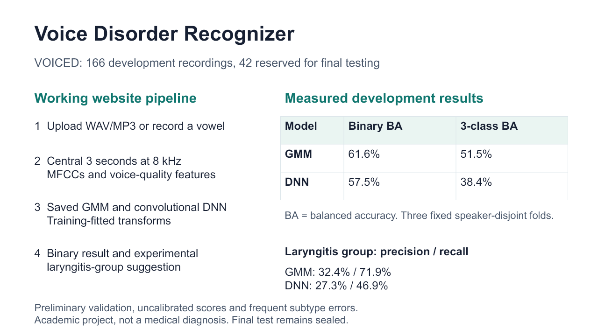
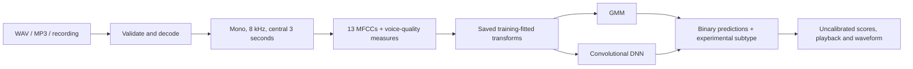

# Voice Disorder Recognizer

A Streamlit application comparing a **Gaussian Mixture Model (GMM)** and a compact **convolutional deep neural network (DNN)** on sustained-vowel recordings.

Upload a WAV or MP3 recording, or record a steady **“aa”** vowel, to view both models' healthy/pathological predictions, an experimental laryngitis-group suggestion, model scores, audio playback and a waveform.

**Academic project, not a medical diagnosis.** Scores are uncalibrated and can be high for an incorrect prediction.



## Quick start

Python **3.12** and a CPU are sufficient. Clone the repository and create an environment:

```bash
git clone https://github.com/Aaditya865/voice_disorder_recognizer.git
cd voice_disorder_recognizer
python -m venv .venv
```

Windows PowerShell:

```powershell
& '.\.venv\Scripts\python.exe' -m pip install --upgrade pip
& '.\.venv\Scripts\python.exe' -m pip install torch==2.14.1 --index-url https://download.pytorch.org/whl/cpu
& '.\.venv\Scripts\python.exe' -m pip install -r requirements.txt
& '.\.venv\Scripts\python.exe' -m streamlit run app.py
```

macOS/Linux:

```bash
.venv/bin/python -m pip install --upgrade pip
# Linux CPU build; on macOS install torch==2.14.1 from the default package index.
.venv/bin/python -m pip install torch==2.14.1 --index-url https://download.pytorch.org/whl/cpu
.venv/bin/python -m pip install -r requirements.txt
.venv/bin/python -m streamlit run app.py
```

Open **http://localhost:8501**. Saved models are included; no dataset download or retraining is needed for the website. On Windows, after setup, `OPEN_WEBSITE.cmd` also launches it. Internet is unnecessary for local inference once dependencies are installed. The Windows environment was verified; other operating systems have not been independently tested.

## Demo samples

Upload one file from `samples/`, then click **Analyze Voice**:

| Sample | Dataset label | Actual website behavior |
|---|---|---|
| `healthy_voice002.wav` | Healthy | Both binary models predict healthy. |
| `pathological_voice003.wav` | Nodule / other pathology | Both predict pathological; both laryngitis suggestions are incorrect. |
| `laryngeal_voice008.wav` | Reflux laryngitis | DNN predicts pathological with the laryngitis group; GMM incorrectly predicts healthy. |

These are actual public-dataset recordings. Exact supplied WAVs automatically use validation-fold models that excluded the corresponding speaker proxy from fitting. Validation informed model-setting selection, so these examples are **not independent final tests**. New or unrecognized uploads use full-development models. Converting a sample can change its fingerprint; use the supplied files unchanged. See [sample provenance](samples/README.md).

## Measured results

All numbers below are **pooled development validation**, not final-test performance. The same development folds selected the binary model settings.

| Metric | GMM | DNN |
|---|---:|---:|
| Binary balanced accuracy | 61.6% | 57.5% |
| Exploratory three-class balanced accuracy | 51.5% | 38.4% |
| Laryngitis-group precision | 32.4% | 27.3% |
| Laryngitis-group recall | 71.9% | 46.9% |
| Laryngitis-group F1 | 44.7% | 34.5% |

The three-class experiment distinguishes **Healthy**, **Laryngeal (laryngitis-labelled)** and **Other pathology**. The dataset has 39 explicitly laryngitis-labelled records, of which 32 are in development. Other diagnoses can also involve the larynx; this is not a broad anatomical classifier. Subtype precision is weak. The website first applies the original binary classifier, then adds an auxiliary subtype suggestion. Its combined decision metrics are reported separately in [LARYNGEAL_REPORT.md](LARYNGEAL_REPORT.md).

The VOICED release contains 208 recordings. Supplied diagnosis metadata yields **57 healthy / 151 pathological**, differing from the website summary of 58/150. Fixed partitions contain **166 development / 42 reserved final-test records**, with three speaker-proxy-disjoint development folds. Record IDs are participant proxies, not independently verified patient identities. The final test remains sealed; no final-test accuracy is claimed.

## Processing and models



- MFCCs use 25 ms frames and 10 ms steps. Voice-quality features are CPPS, HNR, local jitter, local shimmer, median pitch and pitch IQR.
- GMM uses pooled MFCC statistics and quality features. DNN uses MFCC sequences and a quality-feature branch.
- Both reuse the original preprocessing, imputation and scaling implementations. Learned transforms were fit on training subsets only.
- Models are loaded once with Streamlit resource caching. Uploads are processed in memory; the app does not write uploaded audio to disk.
- Files must be WAV/MP3, at most 20 MB, and at least three seconds long. Mono/stereo audio at 8–192 kHz is accepted. For long recordings, decoding is bounded to the central 60 seconds before the shared three-second pipeline.
- The player renders a browser-compatible version of the analyzed segment; playback conversion does not alter inference.

## Repository layout

```text
app.py                         Streamlit interface
voice_review/                  Shared preprocessing, models, experiments, inference
models/                        Binary models, fold models and separate subtype models
data/                          Metadata, audit, feature specification and frozen splits
samples/                       Three attributed public-dataset demo WAVs
results/                       Saved development predictions, metrics and figures
tests/                         Numerical, leakage, inference and interface checks
docs/                          Reproduction, deployment and validation notes
REPORT.md                      Original academic report
LARYNGEAL_REPORT.md             Diagnosis audit and exploratory subtype analysis
ROBUSTNESS.md                  Additional development seed runs
DEMO_AND_QA.md                  Two-minute demonstration and reviewer questions
Voice_Disorder_Review.ipynb     Earlier notebook demonstration
Review.html                    Offline presentation of saved results
```

Raw dataset audio, feature caches, virtual environments, partial downloads and private Streamlit secrets are excluded from Git. The trained artifacts and their integrity records are included.

## Validation and reproducibility

The complete original local dataset environment passed **43 tests**. This clean checkout omits raw audio; source-audio-only checks skip until the release is downloaded. Run:

```powershell
& '.\.venv\Scripts\python.exe' -m pytest -q
```

For full checks and experiment reproduction, see [docs/REPRODUCIBILITY.md](docs/REPRODUCIBILITY.md). Original binary scientific artifacts retain their frozen hashes; subtype artifacts have a separate provenance record. `requirements-lock.txt` records the original scientific environment; `requirements-web-lock.txt` records the later complete Windows website environment. Direct requirements are pinned for model compatibility.

## Review and deployment

- [Two-minute demo and 10 reviewer questions](DEMO_AND_QA.md)
- [Editable architecture/results slide](Architecture_and_Results.pptx)
- [Optional cloud deployment](docs/DEPLOYMENT.md)
- Offline fallback: open `Review.html` or `Architecture_and_Results.png`.

## Sources and limitations

The reference paper, [Gupta et al. (2026)](https://doi.org/10.3389/fdgth.2026.1800132), is a scoping review, not a benchmark proving our model pair is best. The dataset is [VOICED 1.0.0](https://physionet.org/content/voiced/1.0.0/) ([DOI](https://doi.org/10.13026/C25Q2N)). See [REFERENCES.txt](REFERENCES.txt), [DATA_CARD.md](DATA_CARD.md) and [NOTICE.md](NOTICE.md) for attribution.

This small, single-source experiment has weak subtype precision, unstable DNN training results, uncalibrated scores and no external or phone-microphone validation. Ordinary conversation, singing, music and arbitrary audio are outside the trained task. The waveform and score do not establish medical validity.
