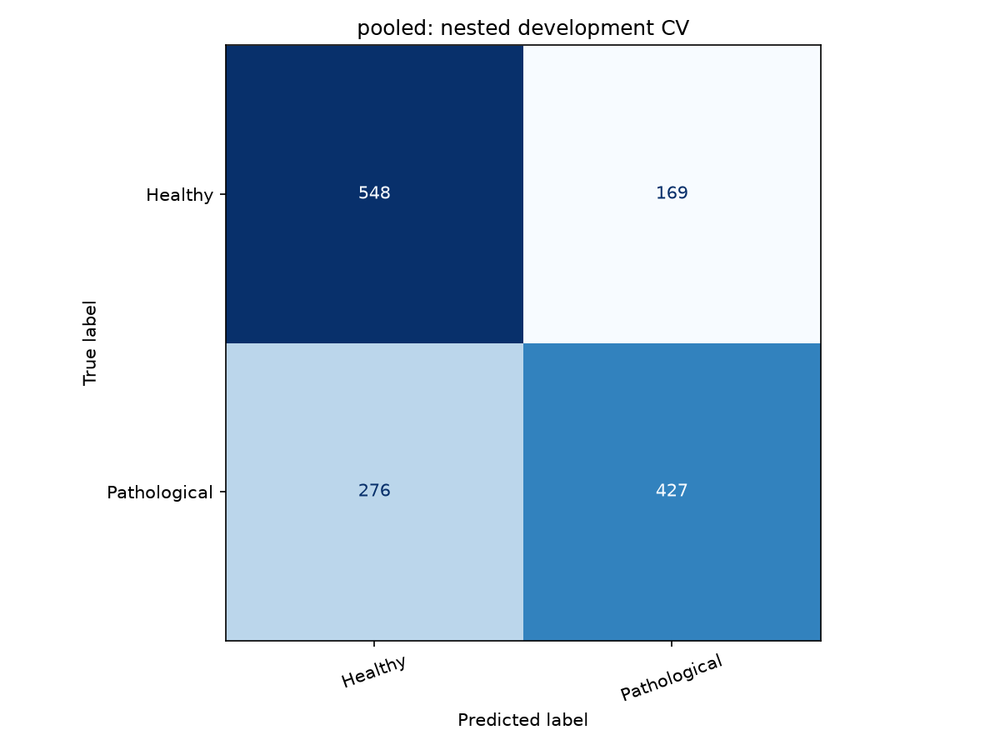
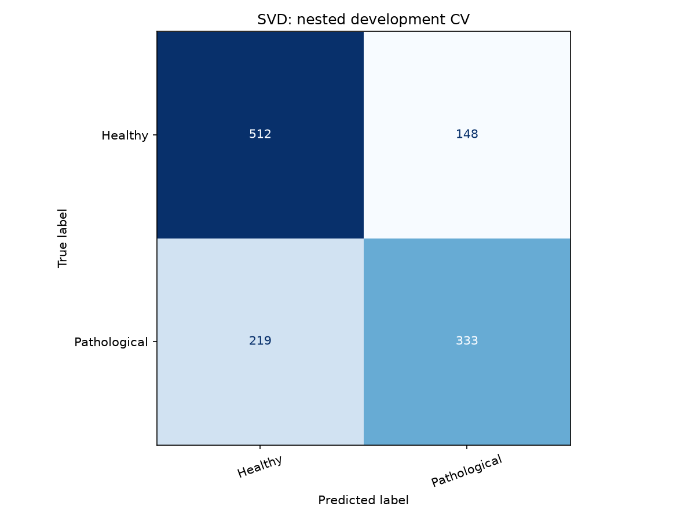
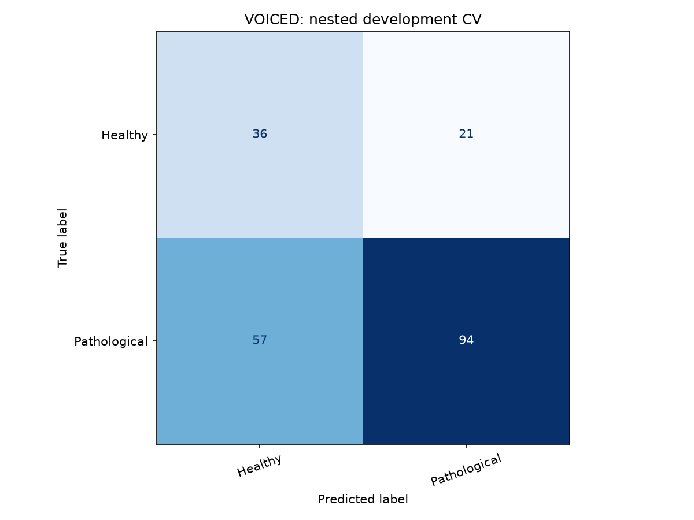

# Voice Disorder Recognizer — two-source development experiment

**Academic project, not a medical diagnosis.** This revision has no genuinely untouched external test.

## Dataset and label audit

| source | label | recordings | speakers | median_age | min_age | max_age |
| --- | --- | --- | --- | --- | --- | --- |
| SVD | 0 | 660 | 660 | 22.467265 | 9.590888 | 84.382294 |
| SVD | 1 | 552 | 552 | 50.719727 | 12.706626 | 94.709679 |
| VOICED | 0 | 57 | 57 | 35.000000 | 20.000000 | 66.000000 |
| VOICED | 1 | 151 | 151 | 47.000000 | 18.000000 | 70.000000 |

One record per SVD participant. VOICED record IDs are participant proxies; cross-session identity cannot be independently reverified. VOICED release labels give 57 healthy and 151 pathological records, differing from its website summary. Headers and detailed metadata agree on binary status; detailed diagnosis wording can differ. All 208 VOICED records, including the previously evaluated 42, are development data in this revision.

## Selection and evaluation protocol

Four outer participant-disjoint folds evaluate a procedure using three inner folds. Strata combine source and binary label. Fit imputation, scaling, PCA/selection and balancing inside fitting partitions. Separate speakers support temperature calibration and CNN stopping. Selection maximizes the mean of source-specific balanced accuracies. Within 0.01 of the best score, prefer GMM, MLP, CNN, then ensemble. Outer folds are never used to choose the final artifact; repeat the inner procedure on all development data for final fitting.

Final chosen configuration: **MLP_medium_8000**. Members: MLP_medium_8000.
Comparison models: GMM_4_8000 and MLP_medium_8000.

| outer_fold | chosen | members | threshold |
| --- | --- | --- | --- |
| 0 | CNN_aug_16000 | CNN_aug_16000 | 0.700000 |
| 1 | CNN_aug_8000 | CNN_aug_8000 | 0.800000 |
| 2 | CNN_aug_16000 | CNN_aug_16000 | 1.010000 |
| 3 | CNN_aug_16000 | CNN_aug_16000 | 1.010000 |

The rows below assess family-selection procedures across outer folds. They do not independently test the final refitted artifact. All scores are development estimates; dataset familiarity and source-specific biases remain. Bootstrap intervals resample participant proxies within source and class; they condition on saved predictions and do not measure uncertainty from retraining.

## Nested model comparison

| Procedure | Source | N | balanced_accuracy | macro_f1 | sensitivity | specificity | roc_auc |
| --- | --- | --- | --- | --- | --- | --- | --- |
| selection | pooled | 1420 | 0.685869 +/- 0.032867 | 0.683072 +/- 0.034636 | 0.607516 +/- 0.083815 | 0.764223 +/- 0.067823 | 0.755265 +/- 0.020564 |
| selection | SVD | 1212 | 0.689509 +/- 0.036244 | 0.689462 +/- 0.037189 | 0.603261 +/- 0.078354 | 0.775758 +/- 0.060201 | 0.757027 +/- 0.018172 |
| selection | VOICED | 208 | 0.626670 +/- 0.059256 | 0.584117 +/- 0.064148 | 0.623578 +/- 0.165100 | 0.629762 +/- 0.216143 | 0.691110 +/- 0.052531 |
| GMM | pooled | 1420 | 0.624676 +/- 0.044172 | 0.605847 +/- 0.053987 | 0.418206 +/- 0.105214 | 0.831145 +/- 0.087218 | 0.695009 +/- 0.062122 |
| GMM | SVD | 1212 | 0.639196 +/- 0.036408 | 0.629081 +/- 0.044390 | 0.442029 +/- 0.115791 | 0.836364 +/- 0.103682 | 0.711836 +/- 0.039769 |
| GMM | VOICED | 208 | 0.550687 +/- 0.028393 | 0.431699 +/- 0.091394 | 0.332326 +/- 0.216938 | 0.769048 +/- 0.237093 | 0.617977 +/- 0.092980 |
| DNN | pooled | 1420 | 0.685869 +/- 0.032867 | 0.683072 +/- 0.034636 | 0.607516 +/- 0.083815 | 0.764223 +/- 0.067823 | 0.755265 +/- 0.020564 |
| DNN | SVD | 1212 | 0.689509 +/- 0.036244 | 0.689462 +/- 0.037189 | 0.603261 +/- 0.078354 | 0.775758 +/- 0.060201 | 0.757027 +/- 0.018172 |
| DNN | VOICED | 208 | 0.626670 +/- 0.059256 | 0.584117 +/- 0.064148 | 0.623578 +/- 0.165100 | 0.629762 +/- 0.216143 | 0.691110 +/- 0.052531 |

Means +/- sample standard deviations across four outer folds. Full precision: artifacts_v3/nested_metrics.csv.

## Pooled outer predictions and confidence intervals

### pooled

Accuracy 0.686620; balanced accuracy 0.685846 (bootstrap 95% interval 0.661871–0.708510); macro-F1 0.684328; AUC 0.741254.
Sensitivity 0.607397; specificity 0.764296; Brier 0.203804; ECE 0.046200.
Confusion counts: TN=548, FP=169, FN=276, TP=427.
Accepted coverage 0.184507; accepted count 262; accepted accuracy 0.8091603053435115.

| Class | precision | recall | f1-score | support |
| --- | --- | --- | --- | --- |
| Healthy | 0.665049 | 0.764296 | 0.711226 | 717.000000 |
| Pathological | 0.716443 | 0.607397 | 0.657429 | 703.000000 |
| accuracy | 0.686620 | 0.686620 | 0.686620 | 0.686620 |
| macro avg | 0.690746 | 0.685846 | 0.684328 | 1420.000000 |
| weighted avg | 0.690492 | 0.686620 | 0.684593 | 1420.000000 |

### SVD

Accuracy 0.697195; balanced accuracy 0.689509 (bootstrap 95% interval 0.662862–0.715994); macro-F1 0.690443; AUC 0.744483.
Sensitivity 0.603261; specificity 0.775758; Brier 0.200450; ECE 0.056096.
Confusion counts: TN=512, FP=148, FN=219, TP=333.
Accepted coverage 0.193894; accepted count 235; accepted accuracy 0.8127659574468085.

| Class | precision | recall | f1-score | support |
| --- | --- | --- | --- | --- |
| Healthy | 0.700410 | 0.775758 | 0.736161 | 660.000000 |
| Pathological | 0.692308 | 0.603261 | 0.644724 | 552.000000 |
| accuracy | 0.697195 | 0.697195 | 0.697195 | 0.697195 |
| macro avg | 0.696359 | 0.689509 | 0.690443 | 1212.000000 |
| weighted avg | 0.696720 | 0.697195 | 0.694516 | 1212.000000 |

### VOICED

Accuracy 0.625000; balanced accuracy 0.627048 (bootstrap 95% interval 0.547926–0.692924); macro-F1 0.593383; AUC 0.661555.
Sensitivity 0.622517; specificity 0.631579; Brier 0.223349; ECE 0.175947.
Confusion counts: TN=36, FP=21, FN=57, TP=94.
Accepted coverage 0.129808; accepted count 27; accepted accuracy 0.7777777777777778.

| Class | precision | recall | f1-score | support |
| --- | --- | --- | --- | --- |
| Healthy | 0.387097 | 0.631579 | 0.480000 | 57.000000 |
| Pathological | 0.817391 | 0.622517 | 0.706767 | 151.000000 |
| accuracy | 0.625000 | 0.625000 | 0.625000 | 0.625000 |
| macro avg | 0.602244 | 0.627048 | 0.593383 | 208.000000 |
| weighted avg | 0.699474 | 0.625000 | 0.644624 | 208.000000 |

## Candidate searches

Each stage used only its own development partitions. Scores here were used for selection and are not independent test results. The final-development rows compare all candidate settings on identical inner folds.

| id | source | score | balanced_accuracy | macro_f1 | sensitivity | specificity | roc_auc |
| --- | --- | --- | --- | --- | --- | --- | --- |
| GMM_1_16000 | pooled | 0.577490 | 0.596448 | 0.538053 | 0.236131 | 0.956764 | 0.695104 |
| GMM_1_16000 | SVD | 0.577490 | 0.593692 | 0.543716 | 0.219203 | 0.968182 | 0.685996 |
| GMM_1_16000 | VOICED | 0.577490 | 0.561287 | 0.442256 | 0.298013 | 0.824561 | 0.627977 |
| GMM_1_8000 | pooled | 0.575238 | 0.597953 | 0.543435 | 0.247511 | 0.948396 | 0.711416 |
| GMM_1_8000 | SVD | 0.575238 | 0.592325 | 0.543267 | 0.221014 | 0.963636 | 0.703302 |
| GMM_1_8000 | VOICED | 0.575238 | 0.558150 | 0.460741 | 0.344371 | 0.771930 | 0.624492 |
| GMM_4_16000 | pooled | 0.580016 | 0.640633 | 0.637980 | 0.547653 | 0.733612 | 0.671456 |
| GMM_4_16000 | SVD | 0.580016 | 0.664097 | 0.664707 | 0.579710 | 0.748485 | 0.710354 |
| GMM_4_16000 | VOICED | 0.580016 | 0.495934 | 0.452567 | 0.430464 | 0.561404 | 0.569653 |
| GMM_4_8000 | pooled | 0.609141 | 0.645920 | 0.640682 | 0.517781 | 0.774059 | 0.681768 |
| GMM_4_8000 | SVD | 0.609141 | 0.659783 | 0.659470 | 0.536232 | 0.783333 | 0.703025 |
| GMM_4_8000 | VOICED | 0.609141 | 0.558499 | 0.499197 | 0.450331 | 0.666667 | 0.621122 |
| GMM_tied_16000 | pooled | 0.612969 | 0.630209 | 0.596999 | 0.337127 | 0.923291 | 0.684917 |
| GMM_tied_16000 | SVD | 0.612969 | 0.646294 | 0.629870 | 0.371377 | 0.921212 | 0.718687 |
| GMM_tied_16000 | VOICED | 0.612969 | 0.579644 | 0.406826 | 0.211921 | 0.947368 | 0.595213 |
| GMM_tied_8000 | pooled | 0.613388 | 0.640333 | 0.614310 | 0.374111 | 0.906555 | 0.711464 |
| GMM_tied_8000 | SVD | 0.613388 | 0.661364 | 0.650993 | 0.416667 | 0.906061 | 0.739279 |
| GMM_tied_8000 | VOICED | 0.613388 | 0.565412 | 0.403678 | 0.218543 | 0.912281 | 0.598699 |
| MLP_small_16000 | pooled | 0.618120 | 0.665262 | 0.662729 | 0.570413 | 0.760112 | 0.712450 |
| MLP_small_16000 | SVD | 0.618120 | 0.666123 | 0.666160 | 0.548913 | 0.783333 | 0.713315 |
| MLP_small_16000 | VOICED | 0.618120 | 0.570117 | 0.555417 | 0.649007 | 0.491228 | 0.606599 |
| MLP_small_8000 | pooled | 0.614770 | 0.682696 | 0.679260 | 0.570413 | 0.794979 | 0.717600 |
| MLP_small_8000 | SVD | 0.614770 | 0.683416 | 0.682877 | 0.538043 | 0.828788 | 0.715525 |
| MLP_small_8000 | VOICED | 0.614770 | 0.546125 | 0.540964 | 0.688742 | 0.403509 | 0.589520 |
| MLP_medium_16000 | pooled | 0.608405 | 0.657352 | 0.657006 | 0.617354 | 0.697350 | 0.706123 |
| MLP_medium_16000 | SVD | 0.608405 | 0.665399 | 0.665883 | 0.614130 | 0.716667 | 0.717921 |
| MLP_medium_16000 | VOICED | 0.608405 | 0.551412 | 0.537060 | 0.629139 | 0.473684 | 0.585802 |
| MLP_medium_8000 | pooled | 0.627968 | 0.682412 | 0.682387 | 0.684211 | 0.680614 | 0.727780 |
| MLP_medium_8000 | SVD | 0.627968 | 0.678673 | 0.678775 | 0.646739 | 0.710606 | 0.722499 |
| MLP_medium_8000 | VOICED | 0.627968 | 0.577263 | 0.580632 | 0.821192 | 0.333333 | 0.614616 |
| CNN_aug_16000 | pooled | 0.619908 | 0.672611 | 0.671611 | 0.608819 | 0.736402 | 0.747335 |
| CNN_aug_16000 | SVD | 0.619908 | 0.671673 | 0.672316 | 0.579710 | 0.763636 | 0.746316 |
| CNN_aug_16000 | VOICED | 0.619908 | 0.568142 | 0.563411 | 0.715232 | 0.421053 | 0.632044 |
| CNN_aug_8000 | pooled | 0.629104 | 0.689919 | 0.687678 | 0.596017 | 0.783821 | 0.756798 |
| CNN_aug_8000 | SVD | 0.629104 | 0.698024 | 0.698881 | 0.586957 | 0.809091 | 0.767268 |
| CNN_aug_8000 | VOICED | 0.629104 | 0.560184 | 0.544036 | 0.629139 | 0.491228 | 0.593935 |
| Ensemble | pooled | 0.633730 | 0.699051 | 0.698993 | 0.674253 | 0.723849 | 0.744125 |
| Ensemble | SVD | 0.633730 | 0.702454 | 0.703192 | 0.650362 | 0.754545 | 0.745671 |
| Ensemble | VOICED | 0.633730 | 0.565005 | 0.565005 | 0.761589 | 0.368421 | 0.628791 |

## Demographics, errors and interpretation

| source | attribute | value | n | healthy | pathological | inconclusive_small_group | accuracy | balanced_accuracy | macro_f1 | sensitivity | specificity | roc_auc | brier | log_loss | ece | tn | fp | fn | tp |
| --- | --- | --- | --- | --- | --- | --- | --- | --- | --- | --- | --- | --- | --- | --- | --- | --- | --- | --- | --- |
| SVD | sex | f | 759 | 405 | 354 | False | 0.699605 | 0.691484 | 0.690952 | 0.570621 | 0.812346 | 0.749299 | 0.200679 | 0.585201 | 0.067730 | 329.000000 | 76.000000 | 152.000000 | 202.000000 |
| SVD | sex | m | 453 | 255 | 198 | False | 0.693157 | 0.689632 | 0.689060 | 0.661616 | 0.717647 | 0.743613 | 0.200065 | 0.579493 | 0.086371 | 183.000000 | 72.000000 | 67.000000 | 131.000000 |
| VOICED | sex | f | 136 | 36 | 100 | False | 0.669118 | 0.703889 | 0.645649 | 0.630000 | 0.777778 | 0.730278 | 0.214051 | 0.607297 | 0.198588 | 28.000000 | 8.000000 | 37.000000 | 63.000000 |
| VOICED | sex | m | 72 | 21 | 51 | False | 0.541667 | 0.494398 | 0.489581 | 0.607843 | 0.380952 | 0.537815 | 0.240912 | 0.682576 | 0.174758 | 8.000000 | 13.000000 | 20.000000 | 31.000000 |
| SVD | age_band | 30-49 | 327 | 137 | 190 | False | 0.623853 | 0.645774 | 0.623501 | 0.510526 | 0.781022 | 0.687245 | 0.226506 | 0.643709 | 0.095583 | 107.000000 | 30.000000 | 93.000000 | 97.000000 |
| SVD | age_band | 50-69 | 289 | 41 | 248 | False | 0.653979 | 0.584628 | 0.528702 | 0.681452 | 0.487805 | 0.637293 | 0.208855 | 0.592076 | 0.249911 | 20.000000 | 21.000000 | 79.000000 | 169.000000 |
| SVD | age_band | 70plus | 59 | 4 | 55 | True | 0.779661 | 0.534091 | 0.503560 | 0.818182 | 0.250000 | 0.777273 | 0.128457 | 0.388322 | 0.202596 | 1.000000 | 3.000000 | 10.000000 | 45.000000 |
| SVD | age_band | under30 | 537 | 478 | 59 | False | 0.756052 | 0.588114 | 0.552856 | 0.372881 | 0.803347 | 0.624353 | 0.187969 | 0.562689 | 0.280800 | 384.000000 | 94.000000 | 37.000000 | 22.000000 |
| VOICED | age_band | 30-49 | 93 | 25 | 68 | False | 0.591398 | 0.594118 | 0.559571 | 0.588235 | 0.600000 | 0.618824 | 0.242891 | 0.689198 | 0.221984 | 15.000000 | 10.000000 | 28.000000 | 40.000000 |
| VOICED | age_band | 50-69 | 73 | 12 | 61 | True | 0.630137 | 0.544399 | 0.511282 | 0.672131 | 0.416667 | 0.624317 | 0.208235 | 0.585826 | 0.228227 | 5.000000 | 7.000000 | 20.000000 | 41.000000 |
| VOICED | age_band | 70plus | 6 | 0 | 6 | True | nan | nan | nan | nan | nan | nan | nan | nan | nan | nan | nan | nan | nan |
| VOICED | age_band | under30 | 36 | 20 | 16 | True | 0.638889 | 0.618750 | 0.614815 | 0.437500 | 0.800000 | 0.621875 | 0.227408 | 0.643059 | 0.091201 | 16.000000 | 4.000000 | 9.000000 | 7.000000 |

Groups with fewer than 20 examples in either class are flagged inconclusive. Differences do not prove a causal demographic shortcut. SVD healthy speakers are substantially younger than pathological speakers. Equal source/class weighting does not remove that confounding. Inspect development_errors.csv for false positives/negatives; no examples were removed because a model predicted them incorrectly.

## Uncertainty policy

Final threshold: 1.01. A value above 1 means all predictions are uncertain. Threshold selection required 80% accepted accuracy, 20% coverage and 20 accepted examples in each source on inner predictions. These are selection criteria, not a performance guarantee. Outer-fold coverage and accepted accuracy are reported above; the app uses the final development-selected threshold.

## Historical external result — preserved

SVD v2 was tested once on 42 reserved VOICED records: balanced accuracy 0.525, sensitivity 4/30, specificity 11/12. It misclassified 26 pathological examples as healthy. Its 0.70 confidence rule accepted 31 cases, only 12 correctly. That result is retained unchanged. Revised VOICED development scores cannot be described as an improvement on a fresh external test.

## Subtype scope

The unchanged v2 GMM ranks Functional dysphonia group, Laryngitis and Vocal fold paresis. It was developed on 185, 73 and 141 SVD speakers respectively, excluding 153 mixed/other cases. Its grouped-CV balanced accuracy was 0.489254 +/- 0.095303. No subtype passed the earlier confidence/coverage criteria; all rankings remain exploratory and uncertain.

## Runtime and software validation

{
  "scope": "Ten fixed development examples; not an accuracy evaluation",
  "model_load_seconds": 0.04662730000563897,
  "median_seconds": 0.362212099997123,
  "p95_seconds": 1.1546348849955392,
  "max_seconds": 1.192129199996998,
  "median_under_five_seconds": true,
  "offline_website_prediction_agreement": true,
  "recordings": [
    {
      "record_id": "SVD:2",
      "source": "SVD",
      "true_label": 0,
      "leading_label": "Healthy",
      "uncertain": true,
      "seconds": 0.17722629999479977,
      "model_score": 0.6616626728137702
    },
    {
      "record_id": "SVD:3",
      "source": "SVD",
      "true_label": 0,
      "leading_label": "Healthy",
      "uncertain": true,
      "seconds": 0.283851300002425,
      "model_score": 0.7331384070348245
    },
    {
      "record_id": "SVD:4",
      "source": "SVD",
      "true_label": 0,
      "leading_label": "Healthy",
      "uncertain": true,
      "seconds": 0.39579589999630116,
      "model_score": 0.6201389349482288
    },
    {
      "record_id": "SVD:105",
      "source": "SVD",
      "true_label": 1,
      "leading_label": "Pathological",
      "uncertain": true,
      "seconds": 0.2606536999956006,
      "model_score": 0.7499589430133684
    },
    {
      "record_id": "SVD:106",
      "source": "SVD",
      "true_label": 1,
      "leading_label": "Pathological",
      "uncertain": true,
      "seconds": 0.32862829999794485,
      "model_score": 0.587330875492161
    },
    {
      "record_id": "SVD:107",
      "source": "SVD",
      "true_label": 1,
      "leading_label": "Pathological",
      "uncertain": true,
      "seconds": 0.2765164000011282,
      "model_score": 0.6262561193480581
    },
    {
      "record_id": "VOICED:voice002",
      "source": "VOICED",
      "true_label": 0,
      "leading_label": "Healthy",
      "uncertain": true,
      "seconds": 1.100369600004342,
      "model_score": 0.7766917785236506
    },
    {
      "record_id": "VOICED:voice019",
      "source": "VOICED",
      "true_label": 0,
      "leading_label": "Healthy",
      "uncertain": true,
      "seconds": 1.0712965999991866,
      "model_score": 0.6862787614348018
    },
    {
      "record_id": "VOICED:voice001",
      "source": "VOICED",
      "true_label": 1,
      "leading_label": "Healthy",
      "uncertain": true,
      "seconds": 1.1088084999937564,
      "model_score": 0.5566663541358794
    },
    {
      "record_id": "VOICED:voice003",
      "source": "VOICED",
      "true_label": 1,
      "leading_label": "Pathological",
      "uncertain": true,
      "seconds": 1.192129199996998,
      "model_score": 0.8110268666596122
    }
  ]
}

## Limitations

This is an academic research demonstration, not clinical screening or diagnosis. There is no new independent final test. The same known datasets informed earlier design decisions. Age/sex, microphone and source differences remain potential confounders. A short sustained vowel does not uniquely identify an underlying disease. Subtype coverage is incomplete, and calibration may fail under domain shift. The search is bounded and does not establish the globally best model. More diverse independently labeled speakers and prospective evaluation are required.

## Sources

- SVD: https://zenodo.org/records/16874898
- VOICED: https://physionet.org/content/voiced/1.0.0/
- Gupta et al. (2026), scoping review: https://doi.org/10.3389/fdgth.2026.1800132
- Saved experiment configuration, source snapshots and predictions: artifacts_v3/.
